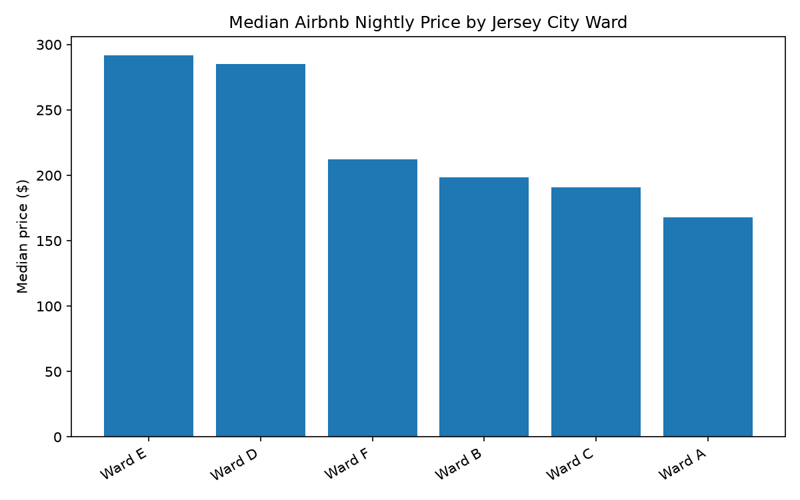
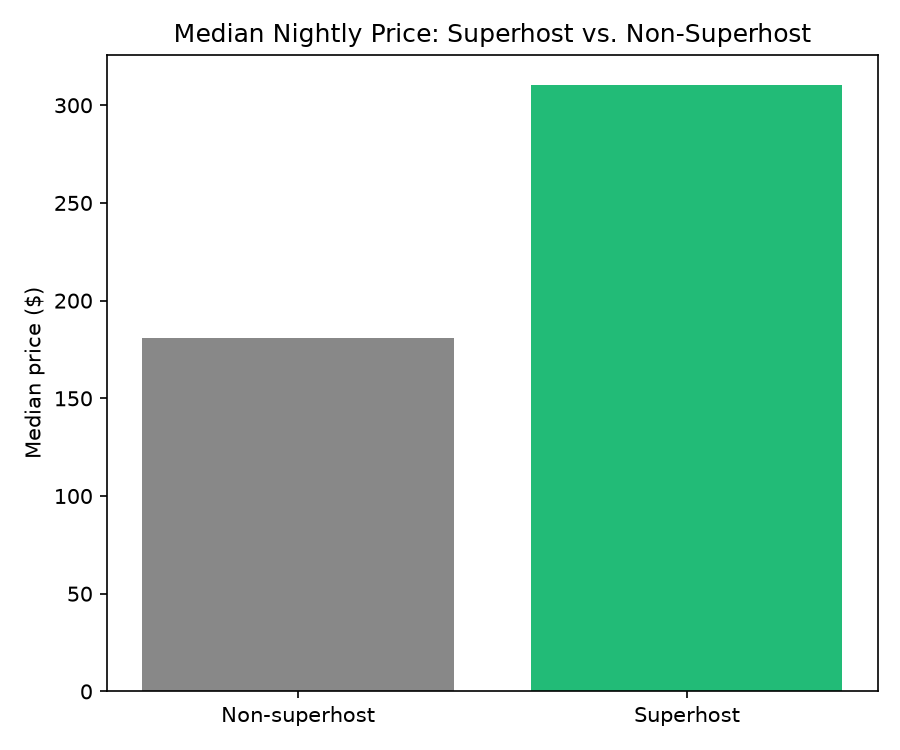
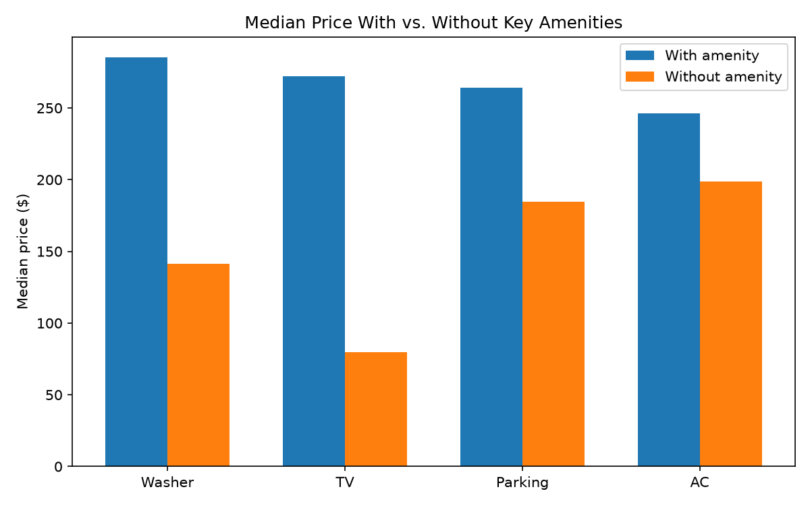

# Jersey City Airbnb Data Cleaning & Analysis

## Purpose
This project cleans and analyzes public Airbnb listing data for Jersey City, NJ from
[Inside Airbnb](https://insideairbnb.com/jersey-city/). The raw data has inconsistent
formats, missing values, and outliers that make it unreliable for analysis as-is. The
goal is to produce a clean, documented dataset and use it to answer basic questions
about pricing, host behavior, and amenities in the Jersey City short-term rental market.

## Data Source
- **Source:** Inside Airbnb, Jersey City snapshot
- **File used:** `listings.csv.gz` (detailed listings data)
- **Rows:** 2,320 listings
- **Columns:** 90 original → 89 after cleaning

## Method
1. **Profiling** — reviewed shape, data types, null counts, and duplicates before any changes
2. **Cleaning** — see `cleaning_log.csv` for the full list of 15 issues found and how each was resolved, including:
   - Dropped 13 fully empty columns
   - Converted `price` from text to numeric, investigated missing and outlier values
   - Converted 4 boolean fields from text ("t"/"f") to true booleans
   - Parsed `bathrooms_text` into a numeric value and a shared/private flag
   - Parsed `amenities` from a JSON string into a list, a count, and 7 individual amenity flags
   - Converted review dates to proper datetime format
   - Documented and explained remaining missing values (bedrooms, license, host bio, host location) rather than guessing fill values
3. **Analysis** — answered three questions on the cleaned data (below)

## Key Findings

**1. Price varies substantially by ward and room type**
Median nightly price ranges from $292 (Ward E) to $168 (Ward A) — a 74% gap across
Jersey City's six wards. Entire homes rent for roughly 3.8x the median price of
private rooms ($322 vs. $85). Shared rooms are too rare in this market (n=3) to
draw a reliable conclusion.

**2. Superhosts charge more and earn higher review scores**
Superhosts have a median nightly price of $310 vs. $181 for non-superhosts (a 72%
difference), and a higher average review score (4.86 vs. 4.63). This likely reflects
superhost status correlating with higher-end, well-reviewed listings rather than
superhosts competing on price.

**3. Certain amenities correlate with higher prices**
Listings with an in-unit washer, TV, parking, or air conditioning show meaningfully
higher median prices than listings without. The washer gap is largest (+$144, nearly
double). Wifi and kitchen comparisons weren't reliable due to very few listings
lacking them.

## Limitations
- This analysis is based on a single snapshot in time, not trends over time
- Findings are correlational, not causal — e.g., amenities likely cluster together
  in larger/newer units rather than each individually driving up price
- Listed prices reflect asking prices, not necessarily prices guests actually paid
- Review scores and amenities are self-reported by hosts and not independently verified

## Files
| File | Description |
|---|---|
| `jersey_city_listings_cleaned.csv` | Final cleaned dataset |
| `cleaning_log.csv` | Every cleaning issue found, rows affected, fix applied, and reasoning |
| `airbnb_jersey_city_cleaning.ipynb` | Full notebook: profiling, cleaning, and analysis code |
| `ward_price_chart.png`, `superhost_price_chart.png`, `amenity_price_chart.png` | Supporting charts |

## Tools
Python, pandas, matplotlib, Jupyter Notebook

## Author
[Josias Disla}